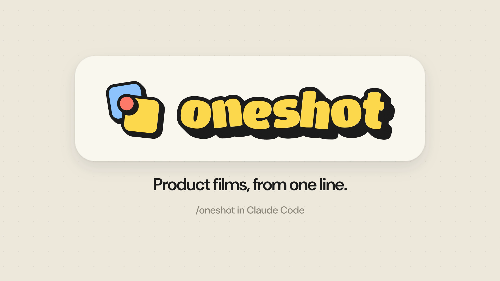
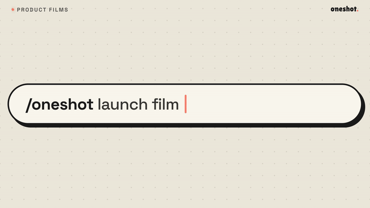
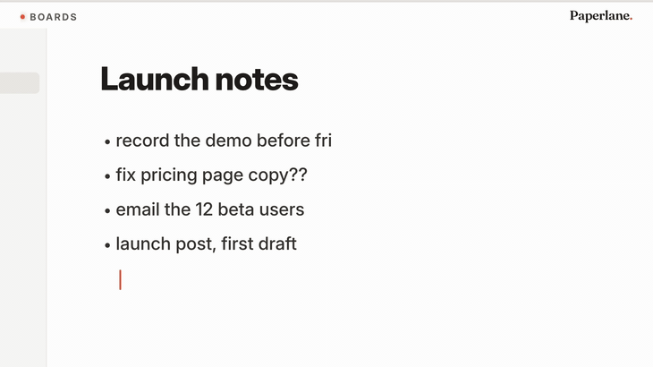

# oneshot

Short product films made from your product's real screens, rendered from code. Every scene grows
out of the last one, so the film never cuts to the next slide.



oneshot is an agent skill. You ask your coding agent for a film of your product. It reads your
product's own colours and fonts and captures the screens the film will show. It proposes three
concepts, then rebuilds the screens in HTML, so numbers roll and rows move. Finally it scores the
film, renders it frame by frame and reviews it before handing it over.

- 30 seconds by default: 15 for one feature, 45 or 60 for a tour.
- 9:16 for the phone feed and 16:9, plus 1:1 and 4:5 when asked.
- A series of films shares one brand, one set of numbers and one set of rules.
- Optional English narration, generated on your own computer.

## Examples

Made with oneshot. Click a film for the MP4 with sound. Paperlane is a made-up product, built for
these samples.

| oneshot | Paperlane |
|---|---|
| [](https://github.com/scalation-ai/oneshot/releases/download/v0.3.0/oneshot-16x9.mp4) | [](https://github.com/scalation-ai/oneshot/releases/download/v0.3.0/paperlane-16x9.mp4) |
| oneshot's own film, about itself: one line, three concepts, one opens into a film that is checked, scored and reshaped into every format. Glide style, 20 s. | A notes and docs app: four messy bullets lift into cards on a board, one card opens into its own page, and it slides to Done. Dive style, 17 s. |

## Install

Claude Code, for you in every project:

```
/plugin marketplace add scalation-ai/oneshot
/plugin install oneshot@oneshot
```

Or for one repository only. From a terminal in the repository:

```
claude plugin marketplace add scalation-ai/oneshot --scope project
claude plugin install oneshot@oneshot --scope project
```

Commit `.claude/settings.json`: everyone who opens the repository in Claude Code and trusts the folder
gets oneshot. Use `--scope local` instead to keep it to yourself in that repository.

Other agents, or Claude Code without plugins:

```
npx skills add scalation-ai/oneshot
```

Then ask your agent for a film of your product, or run `/oneshot`. The first run sets the engine
up and renders a short test film to check it works.

### Update

Claude Code does not update plugins from this marketplace on its own. To get a new version, run:

```
claude plugin marketplace update oneshot
claude plugin update oneshot@oneshot
```

Or open `/plugin`, choose oneshot on the **Installed** tab, then **Update now**. Run `/reload-plugins`
or start a new session to use it. In a repository that installs it for itself, run the commands there:
they update the repository's copy. To update automatically instead, open `/plugin`, choose oneshot on
the **Marketplaces** tab, then **Enable auto-update**.

## Requirements

- Node.js 22 or newer, on macOS or Linux.
- The first run installs HyperFrames, GSAP, Playwright, ffmpeg and a PNG reader inside the skill's
  `engine/` folder, and a headless Chrome for Playwright and one for HyperFrames in their shared
  caches.
- Narration (`--voice`) downloads about 730 MB once. That is Kokoro, a small open text-to-speech
  model that runs on the CPU.
- On Linux, if Chromium will not start, run once: `npx playwright install-deps chromium`.

## How it works

Each film is one HTML page whose `render(t)` sets every element from the time alone, so any frame
renders on its own, and its [GSAP](https://gsap.com) tweens sit on a timeline seeked to the same
time. [HyperFrames](https://github.com/heygen-com/hyperframes) renders it at 60 frames a second,
with a camera shutter's motion blur. The score is a real track cut on its bar lines, with recorded
sounds on the same timeline as the picture.

Everything the skill makes goes in one folder in your project, `oneshot-output/`. Nothing else in
your folder changes. Every film reads three files from that folder:

- `brand.json`: colours, fonts and wordmark, read from your product's own code.
- `story.md`: every number and name that may appear on screen.
- `rules.md`: each feature's promise line, the call to action, and the claims allowed and never
  allowed.

oneshot never invents a number, a promise or a claim. If a film needs one that is not in these
files, it asks you first.

## Options

Say them in words, or pass them as flags (`/oneshot --duration 15 --draft`):

| Option | What it does |
|---|---|
| `--duration <seconds>` | 15, 30 (the default), 45 or 60 |
| `--sound <mood>` | drive, calm, upbeat, bold, playful or minimal |
| `--music <file>` | Your own track, instead of one from the CC0 catalogue |
| `--voice [name]` | A narrator reads each line as it appears, in English |
| `--format <list>` | 9:16, 16:9, 1:1, 4:5, or `all` |
| `--ref <video>` | A clip whose feel the film should have |
| `--draft` | A quick first cut: one concept and a preview only |

## oneshot, HyperFrames and brag

[HyperFrames](https://github.com/heygen-com/hyperframes) is a general framework: it turns HTML,
CSS, media and animations into video, with a CLI, agent skills and a catalog of about 450
ready-made blocks. [brag](https://github.com/latent-spaces/brag) is a skill built on it that turns
the project you just built into a launch video and writes the post to share it.

oneshot renders with HyperFrames, and is narrower: films of a product's own screens, made as a
series.

- **Your real screens, rebuilt.** It captures the screens a film will show and rebuilds them in
  HTML inside your product's own header, sidebar and cards. Numbers roll and rows move, and
  nothing floats as a pitch graphic.
- **One film, not a stack of scenes.** At every change of scene, something on screen carries into
  the next one, and a check measures it.
- **No invented numbers.** Every number and claim comes from your `story.md` and `rules.md`, and
  every film in a series shares them.
- **Real music, cut to the picture.** Your own track, or a public-domain (CC0) one from a short
  catalogue, cut on its bar lines so its drop lands on the reveal. Recorded sounds go on top, each
  on its frame.
- **Checked before you watch.** Carry, rhythm, legibility and sound are checked, then two reviewer
  passes, before the film reaches you.
- **Everything on your computer.** HyperFrames renders, Playwright reads and checks, and narration
  comes from a local model.

Use HyperFrames to build any video from HTML, brag for a launch video of the project you just
built, and oneshot for a series of product films that stay true to the product.

## Support

Maintained by Scalation for our own use. Issues and pull requests are welcome; there is no support
guarantee. To report a security problem, see [SECURITY.md](SECURITY.md).

## Credits

Created by Sai Naw Main (Lwant), [@Lwant-02](https://github.com/Lwant-02), at Scalation, who
maintains it.

Third-party files shipped in `skills/oneshot/engine/`, each with its licence next to it:

- Fonts: DM Sans and Space Grotesk, SIL Open Font License (`fonts/OFL-*.txt`).
- Sounds: all CC0, with each source listed in `sounds/LICENSE.md` (Kenney, unicaegames, Sonic Pi).
- Map data: world-atlas, by Michael Bostock (`data/LICENSE-world-atlas.txt`).

Installed on first run, not shipped here:

- Playwright (Apache-2.0)
- pngjs (MIT)
- ffmpeg-static (GPL-3.0-or-later, for the ffmpeg binary it downloads)
- kokoro-js (Apache-2.0), with the Kokoro model, for narration only

## Licence

Copyright 2026 Scalation Co., Ltd. Apache-2.0: see [LICENSE](LICENSE) and [NOTICE](NOTICE).
Made by [Scalation](https://scalation.ai).
